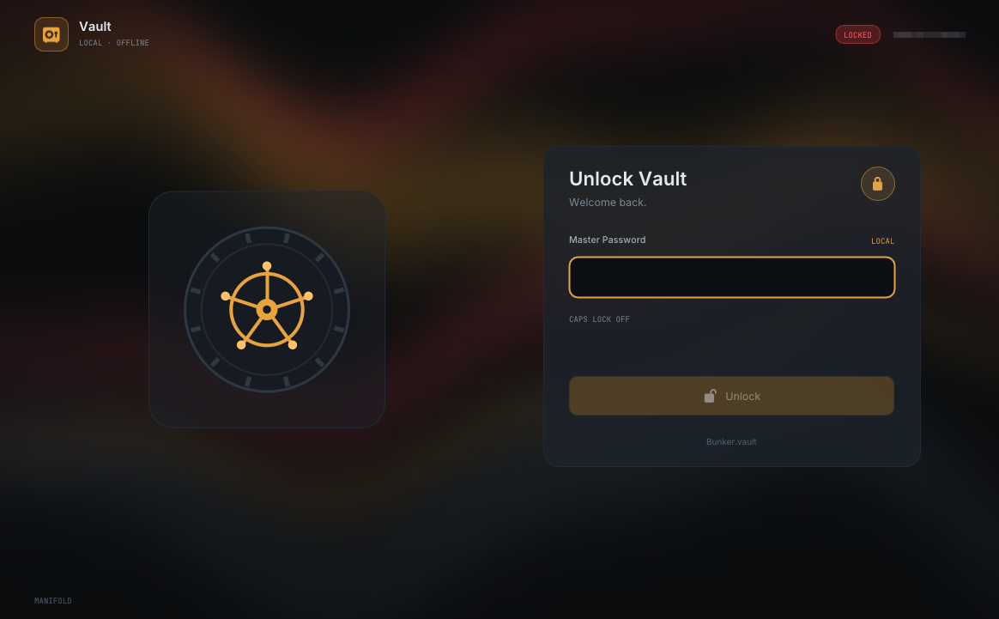
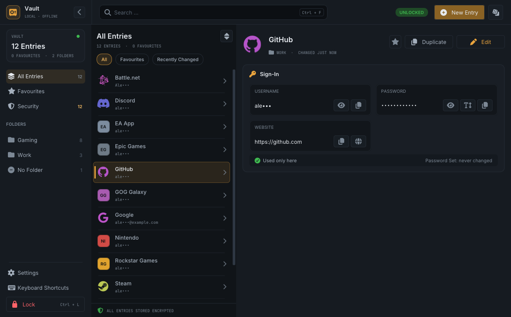
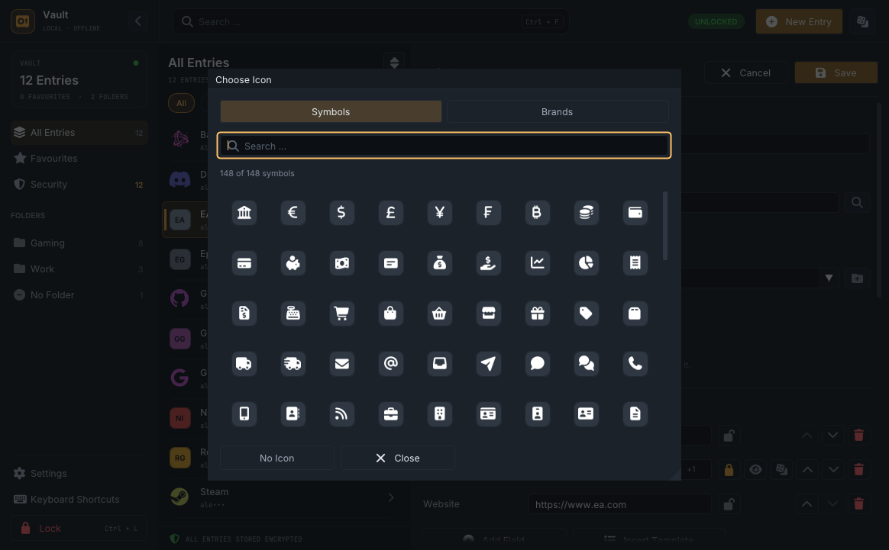
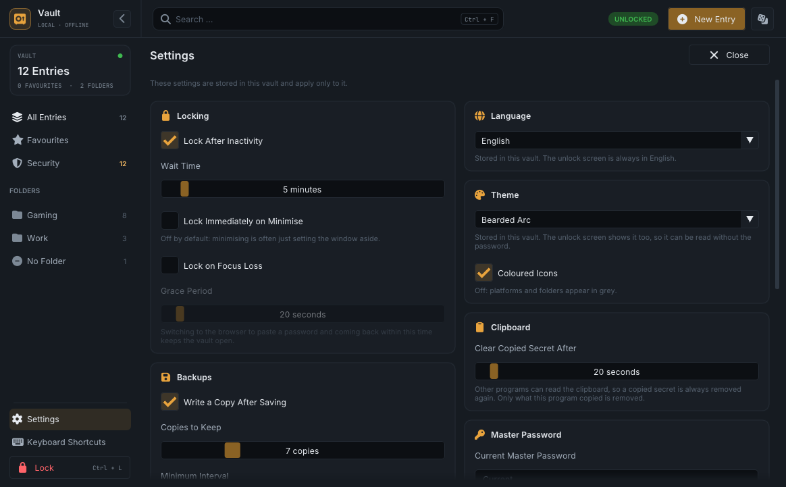
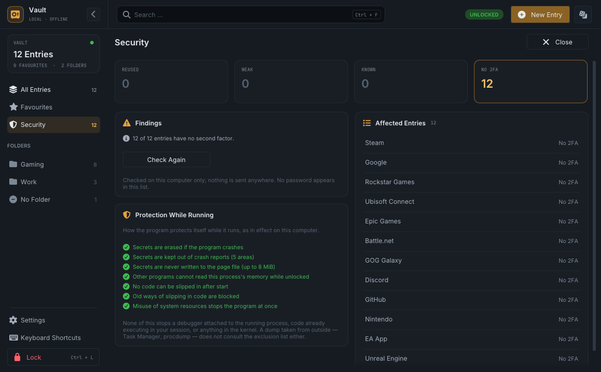

# Manifold Vault

A local, offline password manager for Windows. Everything lives in one encrypted
file next to the program: no account, no cloud, no network access.



## Features

- Entries with username, password, website, notes and custom fields; folders,
  favourites, instant search, sorting, multi-select, undo for deletions.
- Two-factor codes (TOTP) with a live countdown, recovery codes, and lists for
  product keys, security questions and the like.
- Password generator for random passwords and passphrases, with a strength
  estimate.
- Security overview: reused, weak, common and old passwords, and accounts
  without a second factor.
- Password history, stored as keyed fingerprints rather than old passwords.
- CSV import (Bitwarden-style and common column names) and an explicit,
  warned-about plain-text CSV export.
- Automatic backup copies after saving.
- Auto-lock when idle, minimised, on focus loss, when Windows locks or sleeps;
  copied secrets are removed from the clipboard after a delay.
- Ten colour schemes, including a light and a monospace terminal scheme; the
  unlock screen uses the vault's scheme.
- Brand icons for known services, or one of 148 symbols for everything else.
- English and German user interface.

| | |
|---|---|
|  |  |
|  |  |

## Security model

- **Key derivation.** The master password goes through Argon2id (libsodium,
  "moderate": 3 passes, 256 MiB) to a key-encryption key, which unwraps a random
  256-bit vault key. Changing the password rewraps 32 bytes; a failed unwrap
  means a wrong password, a failed body means a damaged file.
- **Encryption.** The body is encrypted with XChaCha20-Poly1305 under a subkey
  of the vault key. The header — KDF parameters, salt, key slot — is part of the
  associated data, so parameters cannot be downgraded and slots cannot be
  swapped. The plaintext is padded to 4 KiB, every save uses fresh nonces, and
  files are replaced atomically.
- **One unencrypted setting.** The colour scheme is stored as one byte in the
  (authenticated) header so the unlock screen can show it. Nothing else about
  the vault is readable without the password.
- **Memory.** Secrets live in locked, guarded memory and are wiped when freed.
  The master password never passes through ImGui's text buffers, and ImGui's
  own allocations are wiped on free.
- **Process.** Screen capture is blocked while the vault is open, other
  processes are denied read access to the process memory, and dynamic code and
  extension points are disabled.
- **Limits.** Nothing protects against malware already running in your session
  while the vault is open: it can read the screen, the keyboard and memory.
  Losing the master password means losing the data — there is no recovery.

## File format

| Region | Size | Content |
|---|---|---|
| A | 96 bytes | magic `BUNKER\x1A\0`, version 1.0, KDF parameters, salt, nonce, generation, colour scheme |
| B | 80 bytes per slot | key slot: the vault key, wrapped by the password key |
| C | 16 bytes | BLAKE2b-128 of A and B, to reject accidental damage early |
| D | rest | XChaCha20-Poly1305 ciphertext of a TLV document |

All integers are little-endian. Records with unknown tags are kept and written
back unchanged, so a file written by a newer version survives a round trip
through an older one. Tag numbers are never reused.

## Building

Requirements: Windows 10 or 11 (x64), Visual Studio 2022 with the C++ desktop
workload.

1. Open `Manifold-Vault.sln`.
2. Build **Release | x64**. The program is `x64\Release\Vault.exe`; the vault
   file `Bunker.vault` is created next to it.

All dependencies are in `Vendor/`: Dear ImGui (source), libsodium (static
libraries), Font Awesome and the two text fonts.

### Tests and checks

```
x64\Release\Bunker.Tests.exe --headless
python Tools\check_ui_scale.py
python Tools\check_no_personal.py
```

`Tools/` also holds the generators for the files in
`Manifold-Vault/Source/Generated/` (icons, symbols, known-answer vectors).

### Command line

| Option | Effect |
|---|---|
| `--vault=<path>` | use a different vault file |
| `--scale=<factor>` | override the display scale (0.5 – 4.0) |
| `--allow-screenshots` | allow screen capture (shown in the title bar) |

## Project layout

```
Manifold-Vault/Source/App     window, session, lock policy, process hardening
Manifold-Vault/Source/Core    crypto, file format, model, import/export, search
Manifold-Vault/Source/UI      screens, editor, widgets
Manifold-Vault/Source/Lang    UI strings (English, German)
Tests/                        unit tests (Bunker.Tests)
Tools/                        checks and generators
Vendor/                       third-party code and fonts
Licenses/                     license texts of the third-party components
```

## Third-party components

| Component | License |
|---|---|
| [Dear ImGui](https://github.com/ocornut/imgui) | [MIT](Licenses/Dear-ImGui.txt) |
| [libsodium](https://libsodium.org) 1.0.22 | [ISC](Licenses/libsodium.txt) |
| [Font Awesome Free](https://fontawesome.com) 7.3.1 | [icons CC BY 4.0, fonts SIL OFL 1.1](Licenses/Font-Awesome-Free.txt) |
| [Inter](https://rsms.me/inter/) | [SIL OFL 1.1](Licenses/Inter.txt) |
| [JetBrains Mono](https://www.jetbrains.com/lp/mono/) | [SIL OFL 1.1](Licenses/JetBrains-Mono.txt) |

Brand icons are trademarks of their respective owners and are used only to
label your own accounts.
